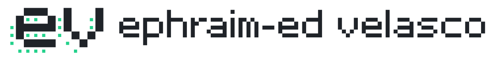

  <picture>
    <source media="(prefers-color-scheme: dark)" srcset="assets/ev-horizontal-dark-1200.png" />
    
  </picture>

  <picture>
    <source media="(prefers-color-scheme: dark)" srcset="https://readme-typing-svg.demolab.com?font=Fira+Code&weight=500&size=20&duration=3500&pause=2000&color=23D18B&center=true&multiline=true&width=700&height=70&lines=Software+Engineer%2C+building+enterprise+web+applications%2C;internal+developer+tools%2C+and+AI-powered+solutions" />
    
  </picture>

  
  
  
  

  
  
  
  
  
  
  
  
  
  
  
  
  
  
  
  
  
  
  
  
  
  

